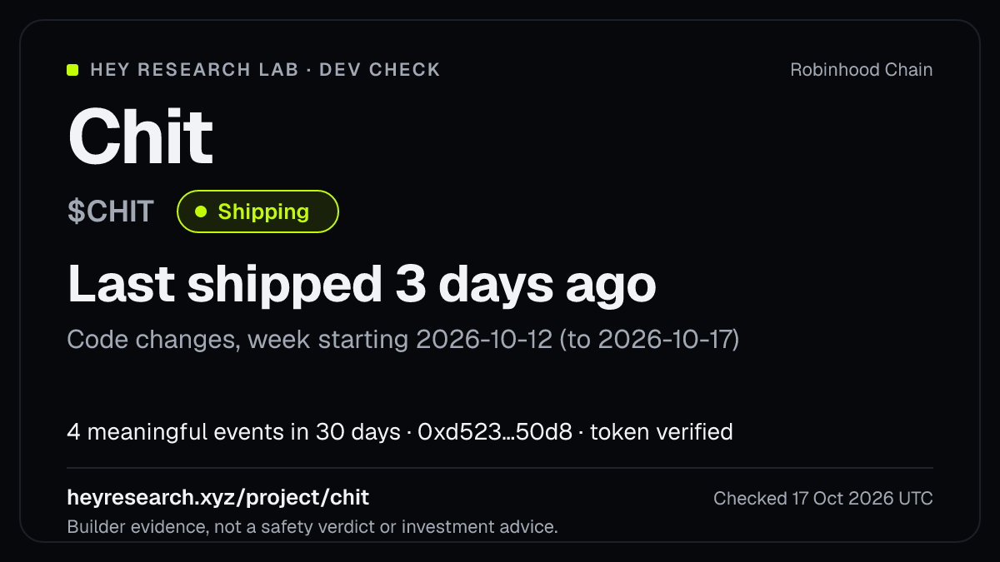
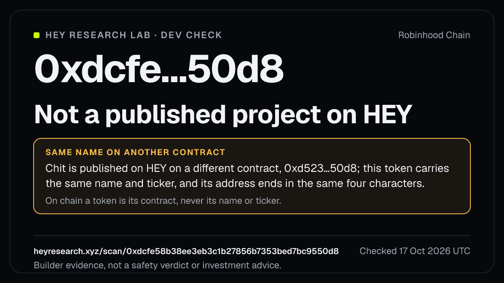

# hey-check

A dev check for any Robinhood Chain token or project: is anyone building it, and what did they
ship? Answered from HEY Research Lab's public record, printed in your terminal and drawn as a
shareable card.

[](https://github.com/hey-research-lab/hey-check/actions/workflows/ci.yml)
[](LICENSE)
[](package.json)
[](https://heyresearch.xyz)



## Why it exists

"Is the dev still building?" is the question people ask about a token before anything else, and
it is usually answered by vibes. HEY Research Lab records, with a source for every fact, which
Robinhood Chain projects are still building and what they shipped. `hey-check` asks HEY that one
question from the command line, prints the answer with its source, and draws it as a 1200×675
PNG you can post on X — the card carries HEY's link, so anyone who sees it can check the record
themselves.

It answers the builder question only. It never gives a safety verdict, a risk score, a price or
a reason to trade.

## Why Robinhood Chain only

HEY researches one chain: Robinhood Chain, chain id `4663` (`eip155:4663`). It is implicit; there
is no network, chain or RPC option. A CAIP-10 address on another chain (`eip155:1:0x…`), or a
`--chain`/`--network` flag, is refused with `unsupported_chain` (exit 2).

## Install

No install needed:

```sh
npx github:hey-research-lab/hey-check '$CHIT'
```

Once it is published to npm:

```sh
npx @hey-research-lab/check '$CHIT'
npm install --global @hey-research-lab/check   # installs the `hey-check` command
```

Node.js 22 or later. No API key, no account. Quote a `$TICKER` in your shell (`'$CHIT'`) so the
shell does not expand it.

## Smallest working example

```sh
hey-check '$CHIT'
```

```text
Chit is shipping consistently: 4 meaningful events in 30 days; latest ship 3 days ago.

  Chit  $CHIT
  Status        Shipping
  Last ship     3 days ago (2026-10-14) — Code changes, week starting 2026-10-12 (to 2026-10-17)
                https://github.com/<owner>/chit-app
  Last 30 days  4 meaningful events
  Contract      0xd523a627030509021cc39b6d7c8543417d3e50d8 · token verified (VERIFIED)
  Unknowns      NOT_MEASURED — HEY read its website and found no link to docs.
                NOT_MEASURED — Its website links no API description.
  Page          https://heyresearch.xyz/project/chit
  Card          ./hey-check-chit.png

Source: HEY Research Lab, builder research for Robinhood Chain — https://heyresearch.xyz/project/chit, as of 2026-10-17, rules hbm-v31
Builder evidence, not a safety verdict or investment advice.
```

The first line is HEY's own answer. Everything below it is HEY's record in HEY's words: the
activity status (Shipping, Active, Resumed, Quiet, Dormant or Unknown), the last meaningful ship
with its title and source, the count of meaningful events in 30 days, the token contract and
whether HEY verified it, and up to two things HEY says it does not know.

## Examples

```sh
hey-check '$CHIT'                                          # a ticker
hey-check 0xd523a627030509021cc39b6d7c8543417d3e50d8       # a contract address
hey-check loom                                             # a project name or slug
hey-check @loomdesktrade                                   # an X handle
hey-check https://x.com/loomdesktrade                      # an X profile URL
hey-check '$CHIT' --tweet                                  # a ready-to-post text
hey-check '$CHIT' --json --no-card | jq .builder           # for scripts and agents
hey-check '$CHIT' --out ~/Desktop/chit.png                 # choose where the card goes
```

### A token that shares a published project's name

On chain a token is its contract, never its name or ticker. When you check a contract HEY has no
published project for, `hey-check` also reads HEY's scan card, and if a published project carries
the same name or ticker on a different contract it says so, as facts, in an amber notice:

```sh
hey-check 0xdcfe58b38ee3eb3c1b27856b7353bed7bc9550d8
```

```text
0xdcfe58b38ee3eb3c1b27856b7353bed7bc9550d8 is not a published project on HEY.

  HEY holds no published project for that contract. That is a statement about HEY’s index, not
  about the token; … A published project carries this token’s name or ticker on a different
  contract: "chit" on 0xd523a627030509021cc39b6d7c8543417d3e50d8 (the same name and ticker; an
  address ending in the same four characters). On chain a token is its contract, never its name
  or ticker.

  Same name or ticker on another contract
    Chit ($CHIT) · 0xd523a627030509021cc39b6d7c8543417d3e50d8 · https://heyresearch.xyz/project/chit

  Scan          https://heyresearch.xyz/scan/0xdcfe58b38ee3eb3c1b27856b7353bed7bc9550d8
  Card          ./hey-check-0xdcfe-50d8.png

Builder evidence, not a safety verdict or investment advice.
```



### More than one match

HEY does not guess, and neither does `hey-check`. A name or ticker that matches several
published projects lists them and exits 7; run it again with one slug or the contract:

```sh
hey-check pepe
```

```text
More than one published project matches. HEY does not guess.

  pepes                                  Pepes ($Pepes) · Shipping · 0xe2c4…5644
  …
  Showing 8 of 19 matches.

Pick one: hey-check pepes   (or pass the token's 0x contract address)
```

## The card

A 1200×675 PNG (X's large image size): the project's name and ticker, HEY's activity status, when
it last shipped and what, the meaningful events in 30 days, the contract and whether HEY verified
it, the HEY page it came from, the UTC date it was checked, and the line "Builder evidence, not a
safety verdict or investment advice." Lime marks HEY's building states (Shipping, Active,
Resumed) and nothing else; amber appears only for a same-name notice.

- Written to `./hey-check-<slug>.png` (or `hey-check-0xabcd-1234.png` for a contract) in the
  current directory, or to `--out <file.png>`. The path must end in `.png` and its directory
  must exist. A symbolic link at the path is refused; nothing is written anywhere else.
- Drawn with the bundled Geist font only (system fonts are never loaded), so it looks the same
  on every machine. Characters Geist cannot draw (emoji, CJK, Arabic …) are left off the card; a
  name with none it can draw shows the project's slug.
- No card for an ambiguous match, or with `--no-card`.

## Options

| Option               | Meaning                                                                                          |
| -------------------- | ------------------------------------------------------------------------------------------------ |
| `--json`             | Print exactly one JSON document (`hey.check/v1`, below) on stdout.                               |
| `--no-card`          | Do not draw the PNG.                                                                             |
| `-o`, `--out <file>` | Where to write the card (must end in `.png`).                                                    |
| `--tweet`            | Print a ready-to-post text instead of the report (the card is still written unless `--no-card`). |
| `--quiet`            | One line: slug, status and last ship (one slug per line for an ambiguous match).                 |
| `--no-color`         | No ANSI styling. Also `NO_COLOR=1`, and whenever stdout is not a terminal.                       |
| `-h`, `--help`       | Help.                                                                                            |
| `-v`, `--version`    | Version.                                                                                         |

`--tweet` prints the builder fact and HEY's page link, under 280 characters as X counts them (a
link counts as 23), and nothing about price:

```text
Dev check on Chit ($CHIT), Robinhood Chain: Shipping. Last shipped 3 days ago; 4 meaningful events in 30 days.

Builder evidence from HEY Research Lab, not a safety verdict: https://heyresearch.xyz/project/chit
```

## JSON output

`--json` prints a stable object built from HEY's answer. It keeps HEY's state words verbatim and
holds builder evidence only: HEY's market and usage context are never read, so no price,
valuation, liquidity or volume field exists in it. A value HEY did not send is `null`, never `0`,
`false` or "none".

```json
{
  "schema": "hey.check/v1",
  "ok": true,
  "outcome": "answered",
  "chain": { "name": "Robinhood Chain", "chainId": 4663, "caip2": "eip155:4663" },
  "input": { "raw": "$CHIT", "kind": "ticker", "sent": { "q": "$CHIT" } },
  "answer": "Chit is shipping consistently: 4 meaningful events in 30 days; latest ship 3 days ago.",
  "project": {
    "slug": "chit",
    "name": "Chit",
    "symbol": "CHIT",
    "url": "https://heyresearch.xyz/project/chit",
    "researchLevel": "VERIFIED_BUILDER",
    "catalogStatus": "VERIFIED_BUILDER"
  },
  "builder": {
    "activityStatus": "SHIPPING",
    "activityLabel": "Shipping",
    "activityMeasured": true,
    "lastMeaningfulShipAt": "2026-10-14T08:20:49.000Z",
    "meaningfulEvents30d": 4
  },
  "latestShip": {
    "id": "ship:74a69137-9a47-401b-b18d-62d4e778d069",
    "title": "Code changes, week starting 2026-10-12 (to 2026-10-17)",
    "occurredAt": "2026-10-14T08:20:49.000Z",
    "precision": "WEEK",
    "sourceUrl": "https://github.com/<owner>/chit-app",
    "receiptUrl": "https://heyresearch.xyz/api/evidence/ship%3A74a69137-9a47-401b-b18d-62d4e778d069"
  },
  "contract": {
    "address": "0xd523a627030509021cc39b6d7c8543417d3e50d8",
    "verification": "VERIFIED"
  },
  "unknowns": [
    {
      "category": "NOT_MEASURED",
      "dimension": "officialDocs",
      "text": "HEY read its website and found no link to docs.",
      "reason": "no_docs_link_found"
    }
  ],
  "candidates": null,
  "candidatesTotal": null,
  "notFound": null,
  "citation": "Source: HEY Research Lab, builder research for Robinhood Chain — https://heyresearch.xyz/project/chit, as of 2026-10-17, rules hbm-v31",
  "page": "https://heyresearch.xyz/project/chit",
  "card": { "path": "./hey-check-chit.png" },
  "tweet": null,
  "boundary": "Builder evidence, not a safety verdict or investment advice.",
  "disclaimer": "Public, source-backed activity HEY recorded. …",
  "error": null,
  "source": {
    "requests": [
      {
        "url": "https://heyresearch.xyz/api/agent/research_project?q=%24CHIT",
        "status": 200,
        "requestId": "…"
      }
    ],
    "asOf": "2026-10-17T22:58:21.063Z",
    "fetchedAt": "2026-10-17T23:00:00.000Z"
  }
}
```

| Field                           | Meaning                                                                                                                                                                                                                                     |
| ------------------------------- | ------------------------------------------------------------------------------------------------------------------------------------------------------------------------------------------------------------------------------------------- |
| `outcome`                       | `answered` (a published project), `ambiguous` (several match; see `candidates`), `not_found` (see `notFound`), or `null` on an error.                                                                                                       |
| `input.kind`                    | `address`, `ticker`, `name`, `handle` or `x_profile`; `input.sent` is the query HEY received.                                                                                                                                               |
| `answer`                        | HEY's answer: its first sentence when answered, HEY's message otherwise.                                                                                                                                                                    |
| `builder.activityStatus`        | HEY's code verbatim: `SHIPPING`, `ACTIVE`, `RESUMED`, `QUIET`, `DORMANT`, `UNKNOWN`; `activityLabel` is its word.                                                                                                                           |
| `latestShip`                    | HEY's latest meaningful change with its evidence id, source URL and receipt; `null` when HEY's answer carries none.                                                                                                                         |
| `contract.verification`         | `VERIFIED`, `UNVERIFIED` or `MISMATCH`, as HEY says it; `contract` is `null` when HEY records no token for the project.                                                                                                                     |
| `unknowns`                      | Every gap HEY lists (deduplicated), with HEY's category (`NOT_MEASURED`, `NOT_VERIFIED`, `STALE`, `INSUFFICIENT_EVIDENCE`, `UNKNOWN`).                                                                                                      |
| `candidates`, `candidatesTotal` | For `ambiguous`: the projects HEY listed, and how many matched in all.                                                                                                                                                                      |
| `notFound`                      | For `not_found`: HEY's message, the contract, the scan page, and `namesakes` (published projects with the same name or ticker on another contract). `namesakesRead: false` means the scan card could not be read — not that there are none. |
| `card`                          | `{ "path" }` when a card was written, else `null`.                                                                                                                                                                                          |
| `tweet`                         | The post text with `--tweet`, else `null`.                                                                                                                                                                                                  |
| `disclaimer`                    | HEY's own disclaimer, relayed.                                                                                                                                                                                                              |
| `error`                         | `{ code, message, retryable, requestId?, retryAfterSeconds? }` on failure (`ok: false`), or when the card could not be written (`ok: true`, exit 1).                                                                                        |

## Exit codes

| Code | Meaning                                                                                                                                                                    |
| ---- | -------------------------------------------------------------------------------------------------------------------------------------------------------------------------- |
| 0    | Answered: HEY holds a published project for the input.                                                                                                                     |
| 1    | Answered, but the card could not be written (path, symlink, permissions).                                                                                                  |
| 2    | Usage error: input that is not an address, `$TICKER`, name, `@handle` or x.com profile URL, the zero or burn address, a bad flag, `unsupported_chain`. No request is made. |
| 3    | HEY refused the request (an `invalid_request` other than `ambiguous`).                                                                                                     |
| 4    | Not published: HEY holds no published project for the input. That is a statement about HEY's index, not about the token.                                                   |
| 5    | Rate limited (429). Wait the printed delay; `hey-check` does not retry.                                                                                                    |
| 6    | Network failure, timeout, redirect, an unreadable or oversized answer, or a HEY 5xx.                                                                                       |
| 7    | More than one published project matches; HEY does not guess. Pick one from the list.                                                                                       |

Codes 0 and 2–6 mean the same in every HEY Research Lab CLI; 1 and 7 are this tool's.

## Use it from an AI agent: the `/devcheck` skill

[`skills/hey-check/SKILL.md`](skills/hey-check/SKILL.md) is an [Agent
Skill](https://agentskills.io/specification). Installed, it lets you ask your coding agent
"/devcheck $CHIT" or "is anyone building 0xd523…?" and get HEY's builder answer with its source
and the boundary that it is not a safety verdict. The agent runs `npx -y
github:hey-research-lab/hey-check <input> --json --no-card` (or, if it is connected, HEY's hosted
MCP server at `https://heyresearch.xyz/mcp`, tool `research_answer`).

**Claude Code** — user scope (every project) or project scope:

```sh
git clone --depth 1 https://github.com/hey-research-lab/hey-check /tmp/hey-check
mkdir -p ~/.claude/skills && cp -R /tmp/hey-check/skills/hey-check ~/.claude/skills/
# or, for one project: cp -R /tmp/hey-check/skills/hey-check .claude/skills/
```

**OpenAI Codex** — Codex reads `~/.agents/skills/` (user) and `.agents/skills/` (repository):

```sh
mkdir -p ~/.agents/skills && cp -R /tmp/hey-check/skills/hey-check ~/.agents/skills/
```

**Cursor** — Cursor reads `~/.cursor/skills/` (user) and `.cursor/skills/` (project):

```sh
mkdir -p ~/.cursor/skills && cp -R /tmp/hey-check/skills/hey-check ~/.cursor/skills/
```

Or with the skills CLI, for any of them: `npx skills add hey-research-lab/hey-check`.

## How it relates to HEY Research Lab

`hey-check` reads HEY's public API with plain HTTPS GET requests to `https://heyresearch.xyz`, at
most two a run:

- `GET /api/agent/research_project?address=<0x…>` for a contract, `?q=<text>` for a `$TICKER`,
  name, slug or `@handle` (HEY's agent answer, AgentIntelligenceResponse v1). When the input is
  exactly one candidate's slug in an `ambiguous` answer, it asks once more with `?project=<slug>`.
- `GET /api/v1/scan?chain=4663&token=<0x…>` only for a contract HEY has no published project for,
  to read `publishedNamesakes`.

It computes nothing of its own: the activity status, the last ship, the event count, the token
verification and every unknown are HEY's, decided by HEY's private quality gate and relayed with
their source. Public API docs: <https://heyresearch.xyz/docs/public-api>. The same answers are
served to agents by the hosted MCP server, <https://heyresearch.xyz/mcp>. For every other read
(ships, changes, evidence, unknowns), use [`@hey-research-lab/cli`](https://github.com/hey-research-lab/hey-cli).

## What it does NOT prove

`hey-check` relays HEY's builder evidence: whether HEY recorded meaningful development and what
was shipped, with its source. It does not prove that a token is safe, that a project is
legitimate, or anything about a token's price or future, and nothing it prints or draws is
investment advice or an endorsement by HEY. A shared name or ticker is a fact about names, not a
verdict on either token. "Not a published project on HEY" is a statement about HEY's index, not
about the token, and an unknown value means HEY does not know — not zero.

HEY Research Lab is an independent research project and is not affiliated with, endorsed by or partnered with Robinhood Markets, Inc. or Robinhood Chain.

## Security

See [SECURITY.md](SECURITY.md). `hey-check` makes HTTPS GET requests to `https://heyresearch.xyz`
only (at most two a run), follows no redirect, gives up after 15 seconds, reads at most 1 MiB of
an answer, and refuses an answer carrying a `__proto__`, `constructor` or `prototype` key. Input
is validated before any request. Text from HEY and its sources (project names, ship titles) is
treated as untrusted: control, escape, invisible and bidirectional-override characters are
stripped before it reaches your terminal, the JSON or the card, and it is XML-escaped into the
card's SVG. It writes one file, the card, at the path shown, never through a symbolic link, and
runs no child processes.

## Contributing

See [CONTRIBUTING.md](CONTRIBUTING.md). `pnpm install && pnpm scan && pnpm lint && pnpm typecheck
&& pnpm test && pnpm build`; tests run against saved fixtures with the network blocked.
`pnpm card:examples` redraws the two example cards in `docs/` from the fixtures. Never commit a
secret or a `.env` with values.

Runtime dependency: [`@resvg/resvg-js`](https://github.com/thx/resvg-js) (MPL-2.0), which turns
the card's SVG into a PNG without a browser — the one dependency the card needs.

## Licence

Code: MIT © 2026 HEY Research Lab. See [LICENSE](LICENSE).

The bundled font, Geist (`assets/fonts/`), is © 2024 The Geist Project Authors and licensed under
the SIL Open Font License 1.1; see [`assets/fonts/OFL.txt`](assets/fonts/OFL.txt).
